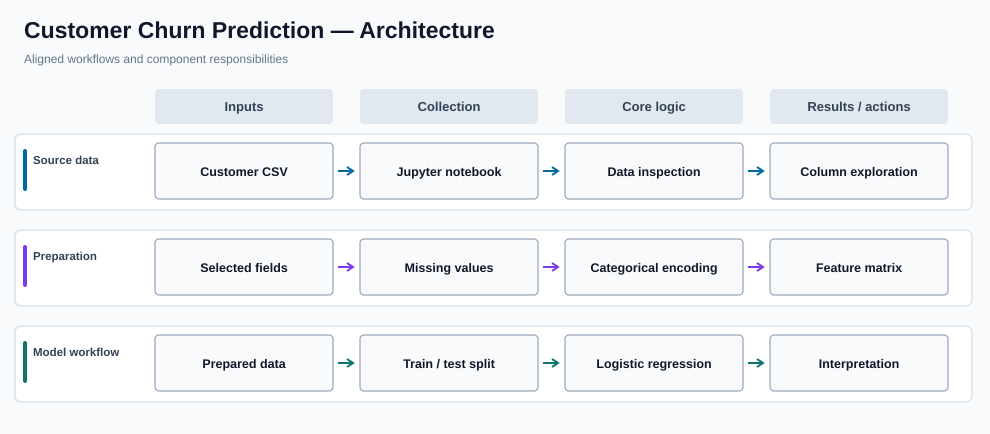

# Customer Churn Prediction

**Customer retention analysis with machine learning**

## Overview

This repository explores customer-churn prediction using structured account and activity data. A Jupyter notebook guides the reader through exploratory analysis, feature preparation, and logistic-regression modeling to identify patterns associated with customers leaving a service.

### Why it matters

Understanding potential customer attrition helps teams prioritize retention investigation. The project demonstrates how raw customer records can be transformed into structured features and used in a supervised classification workflow.

## Key capabilities

- Loads a tabular customer dataset for exploratory analysis.
- Examines customer and account attributes associated with churn.
- Prepares numerical and categorical features for modeling.
- Uses logistic regression as an interpretable classification baseline.
- Keeps analysis and model experimentation in a Jupyter notebook.
- Provides a sample CSV alongside the notebook.

## System architecture



### How the workflow operates

The workflow starts with the repository CSV and explores its columns before transforming fields into model-ready inputs. Data preparation and logistic-regression modeling take place in the notebook, with visual and tabular output used to inspect the analysis.

This is an exploratory machine-learning project rather than a deployed customer-retention service.

## Technology stack

| Technology | Purpose |
| --- | --- |
| **Python** | Notebook analysis and modeling |
| **pandas / NumPy** | Data loading and manipulation |
| **scikit-learn** | Preprocessing and logistic regression |
| **Jupyter Notebook** | Exploration and documentation |
| **Matplotlib / seaborn** | Exploratory visualization, where used |

## Repository structure

```text
Churn_Prediction.ipynb   Main analysis notebook
churn_prediction_simple.csv  Local demonstration dataset
README.md                Project overview and instructions
```

## Getting started

```bash
python3 -m venv .venv
source .venv/bin/activate
pip install notebook pandas numpy scikit-learn matplotlib seaborn
jupyter notebook Churn_Prediction.ipynb
```

## Notes and prerequisites

Use the accompanying CSV in the working directory. The repository is an analysis exercise; it does not implement a live customer scoring API or business retention workflow.
