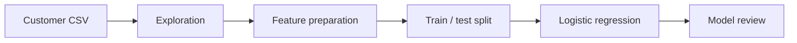

   

<strong>An exploratory notebook for understanding customer churn through tabular analysis, visualization, and logistic-regression baselines.</strong>

## Overview

An exploratory notebook for understanding customer churn through tabular analysis, visualization, and logistic-regression baselines.

### Why it matters

The project shows how customer attributes and activity patterns can be shaped into a clear analytical workflow for retention-focused questions.

## Key features

- Customer and transaction exploratory analysis
- Missing-value handling and categorical encoding
- Derived account-activity features
- Logistic-regression baseline experiments

## Architecture

## Technology stack

**python** · **pandas** · **scikit learn** · **jupyter**

## Getting started

Open `Churn_Prediction.ipynb` in a compatible Jupyter environment with the repository CSV available in the working directory. Run cells in order after reviewing the preprocessing choices.
